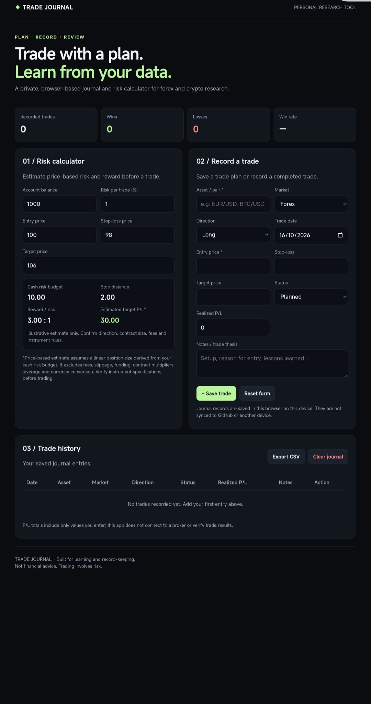

# Trade Journal & Risk Calculator

A responsive, browser-based trade journal and price-based risk calculator for forex and cryptocurrency market research.

## Features

- Calculate cash risk from account balance and risk percentage.
- Estimate stop distance and reward-to-risk ratio.
- Record planned and completed trades.
- Track win rate and recorded profit/loss.
- Save journal entries in browser local storage.
- Export trade history as CSV.
- Responsive dark interface for mobile and desktop.
- No external libraries or backend required.

## Built With

- HTML5
- CSS3
- Vanilla JavaScript
- Browser Local Storage

## Getting Started

1. Open `index.html` in a modern web browser, or visit the GitHub Pages deployment.
2. Enter account and trade prices in the risk calculator.
3. Add a trade to the journal.
4. Export a CSV backup when needed.

## Data and Privacy

Journal entries are stored locally in the browser on the device and browser profile used. They are not automatically synchronized across devices. Clearing browser data may remove saved entries.

Do not use a shared device for sensitive journal information. Export backups regularly.

## Calculation Notes

The calculator estimates cash risk and reward using the price distance between entry, stop-loss and target.

It does not calculate broker-specific lot sizes, contract multipliers, pip values, fees, slippage, leverage requirements, funding charges, or currency conversions. Validate instrument specifications independently before making trading decisions.

## Disclaimer

This project is an educational record-keeping and calculation tool. It is not financial advice, does not connect to a broker, and does not guarantee trading results.

Trading forex and cryptocurrency involves substantial risk.

## Author

Kushal Nagaral

- GitHub: https://github.com/badigerkushal1-wq
- Instagram: https://www.instagram.com/kushaln07/
- LinkedIn: https://www.linkedin.com/in/kushal-nagaral-02346a34a/
- 
## Preview

[Open Live Demo](https://kushalnagaral7.github.io/-trade-journal-risk-calculator/)
